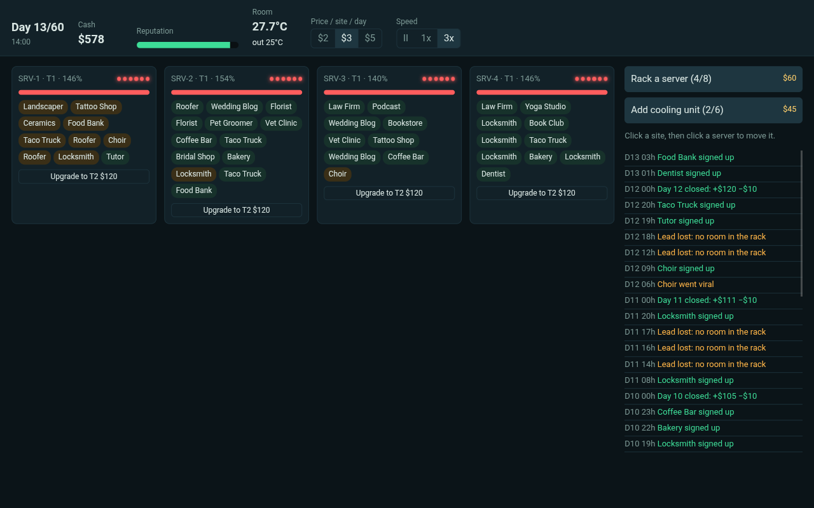

# Uptime: one rack, sixty days

A small management sim made for the Game Gauntlet SIM Jam 2026 (theme: SIMULATION).

You run a tiny web host out of one rack in a back room. Small businesses pay by the day to keep their sites up.
Traffic follows the day, busy servers heat the room, hot rooms kill servers, dead servers take sites down,
unhappy sites cancel, cancellations cost reputation, and reputation is what brings new sign-ups. Survive 60 days.

**Play:** https://designmaster-solutions.github.io/uptime-simjam/ (browser, no install)

## Controls
- Click a site chip, then click a server to move it.
- Rack a server ($60), upgrade it (T2/T3: double/triple capacity, more heat), add cooling ($45), repair a dead server ($40, 6 h).
- Price per site per day: $2 grows fast, $5 grows slow and wears patience. Space pauses.
- **Uptime** in the top bar is the share of site-hours spent on a running server; the end screen shows it with the score.
- **Today's rack**: everyone who opens the shop on the same UTC day gets the same sixty days (same seed, same events), so results are comparable. **Copy result** puts a one-line summary on the clipboard; **Random rack** starts a fresh seed.

## How it is built
Plain HTML/CSS/JS, no engine. `sim.js` is the whole model with no DOM, so it is tested with `npm test`
and balanced with `node tests/bot.mjs` (a simple sensible player survives most seeds; an idle player does not).

## AI disclosure
Code and text were written with AI assistance (Claude) and reviewed by me. No AI-generated art, music or voice:
the look is CSS and the sounds are synthesized with the Web Audio API at runtime.

MIT License · Design Master Solutions
